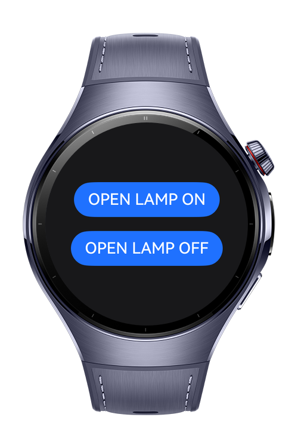

> **Note:** To access all shared projects, get information about environment setup, and view other guides, please visit [Explore-In-HMOS Index](https://github.com/Explore-In-HMOS/hmos-index).

# how-to-control-smart-lights-with-harmonyos-and-mqtt

This project demonstrates a bi-directional communication system between a HarmonyOS application and an Android device using the MQTT protocol to simulate a smart light/device control. The system uses a cloud-based Broker (HiveMQ) to synchronize data instantly.
# Preview

<div>



</div>

# Use Cases

- Lighting & Appliance Control: Control home lights, motorized curtains, or garage doors from either a HarmonyOS device or an Android smartphone.
- Climate Monitoring: Monitor real-time data from temperature and humidity sensors (e.g., ESP32/DHT11) on both platforms simultaneously.

# Tech Stack

- HarmonyOS (DevEco Studio): Main control application.

- ArkTS & TypeScript: Application logic and UI.

- @ohos/mqtt: MQTT library for HarmonyOS.

- Android (MQTT Dash): Mobile monitoring and control interface.

- HiveMQ Cloud: Free public MQTT Broker for testing.

# Directory Structure

```
│   module.json5
│
├───ets
│   ├───entryability
│   │       EntryAbility.ets
│   │
│   ├───entrybackupability
│   │       EntryBackupAbility.ets
│   │
│   └───pages
│           Index.ets
│           MqttManager.ets
│
└───resources
    ├───base
    │   ├───element
    │   │       color.json
    │   │       float.json
    │   │       string.json
    │   │
    │   ├───media
    │   │       background.png
    │   │       foreground.png
    │   │       layered_image.json
    │   │       startIcon.png
    │   │
    │   └───profile
    │           backup_config.json
    │           main_pages.json
    │
    ├───dark
    │   └───element
    │           color.json
    │
    └───rawfile

```

# Constraints and Restrictions
- ESP32 or ESP8266 NodeMCU: A Wi-Fi enabled microcontroller to act as the "receiver."
- Dashboard Application: To visualize the "Light ON/OFF" state without physical hardware, an external MQTT Dashboard app (e.g., MQTT Dash) is required. This app acts as the digital twin of a physical lamp, allowing you to trigger actions and monitor status changes in real-time. 
- To allow the HarmonyOS application to communicate with the MQTT Broker, you must explicitly grant internet permissions in your project configuration.

## Supported Devices

- Huawei Watch 5
- Devices running HarmonyOS 5.0.5 (API 17) and above

# LICENSE

how-to-control-smart-lights-with-harmonyos-and-mqtt is distributed under the terms of the MIT License
See the [LICENSE](./LICENSE) for more information.
